# WordPress Upgrade-Window Security Research Lab

[](https://github.com/WordPress/wordpress-develop/security/advisories/GHSA-4w3m-c66w-69mg)
[](https://opencve.frmgm.io/cve/CVE-2026-119977)
[](https://wordpress.org/news/category/releases/)
[](LICENSE)

An isolated, reproducible security research laboratory and comparative audit of the upgrade-window transient state between **WordPress 7.1.3** and **WordPress 7.1.4**.

> [!CAUTION]
> **Important Research Findings & Boundaries:**
> 1. **Complete unauthenticated Remote Code Execution (RCE) was NOT reproduced.**
> 2. **Advisory Distinction:** The official WordPress advisory [GHSA-4w3m-c66w-69mg](https://github.com/WordPress/wordpress-develop/security/advisories/GHSA-4w3m-c66w-69mg) classifies the issue as **Low** severity and does not publish a CVSS score. Wordfence subsequently assigned [CVE-2026-119977](https://opencve.frmgm.io/cve/CVE-2026-119977) with a **CVSS 3.1 score of 8.1 (High)**, identifying **CWE-367** (Time-of-check Time-of-use Race Condition). These ratings reflect different assessments from different sources and are tracked separately.
> 3. Read the standalone [Security Research & Responsible Use Disclaimer](DISCLAIMER.md) before using or replicating this lab.

---

## 1. Project Overview & Background

On October 15, 2026, the WordPress Core Security Team released **WordPress 7.1.4**, addressing a vulnerability in the core update workflow reported by security researcher **Umut Bayram**.

During a core update, WordPress extracts the new release archive into a temporary staging folder under `/wp-content/upgrade/` before synchronizing the files into the site root via `copy_dir()`. In WordPress 7.1.3, this temporary directory followed deterministic naming based on the archive filename, pre-unpack cleanup purged all existing directory contents (including `index.php`), and `copy_dir()` lacked an exclusion rule for `wp-config.php`.

This repository documents an independent, multi-phase investigation of the underlying source changes, evaluates the transient upgrade window, and assesses defense-in-depth web server controls across Apache, Nginx, and OpenLiteSpeed.

---

## 2. Evidence Classification Framework

To maintain technical accuracy and research integrity, all findings, logs, and demonstrations in this repository adhere to strict evidence classification labels:

| Classification | Meaning | Scope in this Project |
| :--- | :--- | :--- |
| `[LIVE]` | Executed against active containers during testing | Active Apache runtime tree inspection and HTTP 403 assertions |
| `[SIMULATED]` | Filesystem behavior modeled via shell operations | Cleanup loop comparisons and relative-path `copy_dir()` exclusions |
| `[SOURCE-VERIFIED]` | Confirmed by inspecting official upstream source code | Upgrader naming logic, `$skip` array entries, and guard-file checks |
| `[HISTORICAL]` | Telemetry and measurements captured in earlier phases | Upgrade staging lifespans (~11–12s in local Docker lab) and Nginx tests |
| `[STATIC ANALYSIS]` | Configuration syntax and directive analysis only | OpenLiteSpeed context rules (not runtime-validated in container) |
| `[ILLUSTRATIVE]` | Representative sample values | Random alphanumeric tokens shown in directory naming examples |

---

## 3. WordPress 7.1.3 vs 7.1.4 Comparative Analysis

```mermaid
graph TD
    subgraph WP_713["WordPress 7.1.3 (Vulnerable Core Baseline)"]
        A1["Deterministic Naming: wp-content/upgrade/wordpress/"] --> B1["Pre-Unpack Cleanup: Deletes index.php unconditionally"]
        B1 --> C1["File Promotion: $skip omits wp-config.php"]
        C1 --> D1["Outcome: Staged config overwrites production config"]
    end

    subgraph WP_714["WordPress 7.1.4 (Patched Core Protections)"]
        A2["Randomized Naming: wp-content/upgrade/wordpress-{16_RAND_CHARS}/"] --> B2["Pre-Unpack Cleanup: Preserves & auto-creates index.php"]
        B2 --> C2["File Promotion: $skip includes wp-config.php"]
        C2 --> D2["Outcome: Staged config strictly dropped by copy_dir()"]
    end

    style WP_713 fill:#2d1515,stroke:#ef4444,stroke-width:2px;
    style WP_714 fill:#132d21,stroke:#10b981,stroke-width:2px;
```



### Upstream Code Changes Summary

1. **Staging Directory Randomization (`wp-admin/includes/class-wp-upgrader.php`):**
   * *7.1.3:* `$working_dir = $upgrade_folder . basename( basename( $package, '.tmp' ), '.zip' );`
   * *7.1.4:* `$working_dir = $upgrade_folder . $this->get_working_dir_name( $package );` where `get_working_dir_name()` appends 16 random alphanumeric characters via `wp_generate_password(16, false)`.
2. **Directory Guard Preservation & Auto-Creation (`wp-admin/includes/class-wp-upgrader.php`):**
   * *7.1.3:* Loops through `$upgrade_folder` deleting all files unconditionally, stripping `index.php`.
   * *7.1.4:* Explicitly skips `index.php` (`if ( 'index.php' === $file['name'] ) continue;`) and auto-generates an empty `index.php` (`Silence is golden`) if missing.
3. **Configuration Promotion Exclusion (`wp-admin/includes/update-core.php`):**
   * *7.1.3:* `$skip = array( 'wp-content', 'wp-includes/version.php' );`
   * *7.1.4:* `$skip = array( 'wp-content', 'wp-includes/version.php', 'wp-config.php' );`

---

## 4. Isolated Docker Lab Architecture

The lab runs as four isolated containers bound strictly to localhost loopback interfaces (`127.0.0.1`):

```
+-------------------------------------------------------------------------+
| Host Machine (macOS Apple Silicon ARM64 / Linux)                        |
|                                                                         |
|  +---------------------------+       +-------------------------------+  |
|  | Target 1: wp_vuln_app     |       | Target 2: wp_patch_app        |  |
|  | WordPress 7.1.3 (Apache)  |       | WordPress 7.1.4 (Apache)      |  |
|  | http://127.0.0.1:8081/    |       | http://127.0.0.1:8082/        |  |
|  +-------------+-------------+       +---------------+---------------+  |
|                | vuln_net                            | patch_net        |
|  +-------------+-------------+       +---------------+---------------+  |
|  | Database: wp_vuln_db      |       | Database: wp_patch_db         |  |
|  | MariaDB 10.11 (Internal)  |       | MariaDB 10.11 (Internal)      |  |
|  +---------------------------+       +-------------------------------+  |
+-------------------------------------------------------------------------+
```

---

## 5. Research Phases & Documentation

| Phase | Title | Key Artifacts & Reports |
| :--- | :--- | :--- |
| **Phase 1** | Lab Environment Setup | [`docker-compose.yml`](docker-compose.yml), [`evidence/checksums.txt`](evidence/checksums.txt) |
| **Phase 2** | Advisory Investigation | [`docs/vulnerability-analysis.md`](docs/vulnerability-analysis.md), [`evidence/official-references.md`](evidence/official-references.md) |
| **Phase 3** | Source-Code Audit | [`docs/patch-analysis.md`](docs/patch-analysis.md), [`evidence/security-relevant-diff.md`](evidence/security-relevant-diff.md) |
| **Phase 4** | Controlled Property Testing | [`docs/phase-4-test-results.md`](docs/phase-4-test-results.md), [`tests/test-plan.md`](tests/test-plan.md) |
| **Phase 5** | Lifecycle Validation & Timing | [`docs/phase-5-validation-report.md`](docs/phase-5-validation-report.md), [`tests/observe_upgrade_lifecycle.php`](tests/observe_upgrade_lifecycle.php) |
| **Phase 6** | Web Server Hardening Assessment | [`docs/phase-6-hardening-assessment.md`](docs/phase-6-hardening-assessment.md), [`configs/`](configs/) |
| **Phase 7** | Demonstration & Dashboard | [`demo/run_demo.sh`](demo/run_demo.sh), [`demo/index.html`](demo/index.html), [`docs/phase-7-demo-script.md`](docs/phase-7-demo-script.md) |
| **Phase 7.2** | Evidence Package Capture | [`docs/phase-7-2-evidence-capture-report.md`](docs/phase-7-2-evidence-capture-report.md), [`evidence/phase-7-2/`](evidence/phase-7-2/) |
| **Phase 7.3** | Accuracy & Safety Corrections | [`docs/phase-7-3-correction-report.md`](docs/phase-7-3-correction-report.md) |

---

## 6. How to Run the Demonstration

### Prerequisites
* Docker & Docker Compose
* Bash 4+
* `curl`

### Provision Containers
```bash
docker compose up -d
```

### Run Automated Walkthrough Harness
```bash
# Execute complete sequential demonstration (Modules A through D):
./demo/run_demo.sh --all

# Or run individual modules:
./demo/run_demo.sh --demo-a   # Demonstration A: 7.1.3 baseline & relative copy simulation
./demo/run_demo.sh --demo-b   # Demonstration B: 7.1.4 protections & relative copy exclusion
./demo/run_demo.sh --demo-c   # Demonstration C: Upgrade lifecycle walkthrough & timing
./demo/run_demo.sh --demo-d   # Demonstration D: Apache live configuration check & HTTP 403 assertions
```

### View Visual Research Dashboard
Open the local interactive dashboard in any web browser:
```bash
open demo/index.html
```

---

## 7. Web Server Hardening Findings

Testing evaluated whether server-level HTTP restrictions could mitigate the exposure of temporary upgrade files without interfering with legitimate WordPress updates:

| Web Server | Implemented Directive | HTTP Result for `/wp-content/upgrade/` | Update Compatibility | Validation Method |
| :--- | :--- | :--- | :--- | :--- |
| **Apache 2.4+** | `<Directory ...> Require all denied Options -Indexes </Directory>` | `HTTP 403 Forbidden` (Static & PHP) | **Pass** (WP-CLI core update completed) | `[LIVE]` Verified active runtime tree & assertions |
| **Nginx 1.31+** | `location ^~ /wp-content/upgrade/ { deny all; return 403; }` | `HTTP 403 Forbidden` (Static & PHP) | **Pass** (Local filesystem I/O unaffected) | `[HISTORICAL]` Verified in disposable container |
| **OpenLiteSpeed** | `context /wp-content/upgrade/ { type NULL; accessible no; }` | Rule-based 403 | **Compatible** (Local I/O unaffected) | `[STATIC ANALYSIS]` Syntax review only |

*Defense-in-Depth Scope:* Web-server restrictions provide perimeter access controls blocking direct HTTP requests. They do not fix application-level code or mitigate local execution vulnerabilities.

---

## 8. Known Limitations & Research Boundaries

1. **RCE Not Reproduced:** Controlled local research did not attempt or achieve remote code execution.
2. **Timing Windows Are Environment-Specific:** Measured staging directory lifespans (~12.33s for 7.1.3, ~11.32s for 7.1.4) reflect this specific virtualized macOS Docker lab (Colima/VZ filesystem bridge). Bare-metal or NVMe storage environments may exhibit significantly shorter transient windows.
3. **OpenLiteSpeed Evaluation:** OpenLiteSpeed configuration remains evaluated via static directive analysis rather than container runtime.
4. **Video Recording Status:** The Phase 7.2 evidence package is published as an inspected screenshot-and-log release; automated video capture is unrecorded due to headless macOS TCC display boundaries (see [`evidence/phase-7-2/video/recording-instructions.md`](evidence/phase-7-2/video/recording-instructions.md)).

---

## 9. License & Disclaimer

* Documentation, test harnesses, and configuration templates are distributed under the [MIT License](LICENSE).
* Review the mandatory [Security Research & Responsible Use Disclaimer](DISCLAIMER.md) before using this material.
